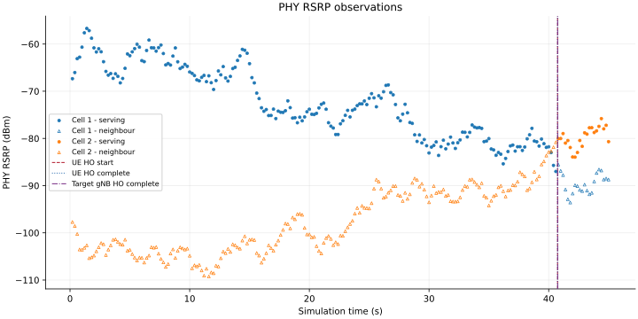
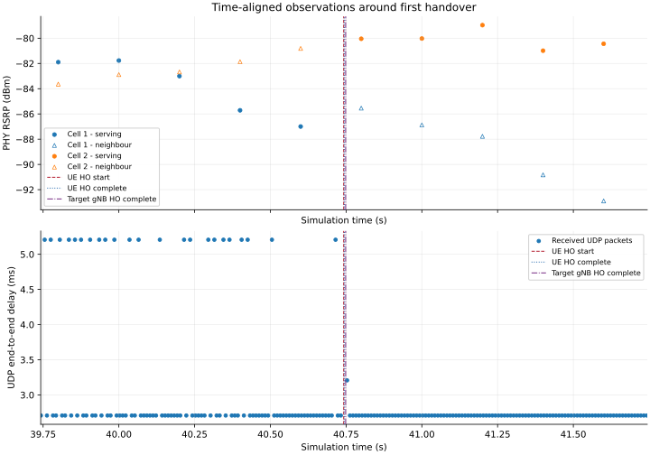

# Digital Twin–Assisted 5G Handover Research

**A reproducible C++/Python research workflow for measuring NR handover and UDP QoS, with a roadmap toward Digital Twin–assisted decision making.**

This independent research repository explores the direction of *Digital Twin-Assisted Handover Scheme for Mobile Networks Using Generative AI* by Lal Verda Cakir, Mehmet Ali Erturk, Mehmet Ozdem, and Berk Canberk. It currently implements the simulation, measurement, offline analysis, and visualization foundations. **It does not reproduce the full paper or implement its Digital Twin / generative-AI algorithms.**

The focus is trace-based verification: a handover is counted only when actual RRC events occur, packet statistics come from recorded transmissions/receptions, and measurement definitions remain explicit.

## Architecture

```text
Remote host -- IPv4 / point-to-point -- EPC (PGW/SGW) -- NR gNB 0
                                                            |
                                                   X2 handover
                                                            |
                                                        NR gNB 1
                                                            |
                                                         Moving UE

ns-3 CSV traces --> offline Python QoS analysis --> Matplotlib figures
```

Two gNBs share one NR bandwidth part. A UE initially attaches to gNB 0 and receives downlink UDP traffic. In the handover scenario, A3-RSRP measurements trigger a real X2 handover to gNB 1. This is **NR with an EPC-based architecture**, not a full 5G Standalone AMF/N2/NG signaling implementation.

## Technologies and implementation status

C++ · Python 3 · ns-3.48 · 5G-LENA · Matplotlib · WSL2 / Ubuntu 24.04

| Phase | Implemented capability | Status |
|---|---|---|
| A | Fixed topology, UE mobility, 30 ms position logging | Validated |
| B1 | NR devices, EPC IPv4 connectivity, initial RRC attachment | Validated |
| B2 | Downlink UDP traffic and delivery accounting | Validated |
| B3 | Measurement-triggered A3-RSRP X2 handover with real RRC | Validated |
| C1 | Offline packet delay, delay variation, reception gaps, window goodput | Validated |
| C2.1 | Passive serving/neighbour RSRP and model-derived RSRQ | Validated |
| C2.2 | Passive native DL DATA / CONTROL SINR | Validated |
| C2.3 | Scientific PNG/SVG visualization | Validated |
| Future | Digital Twin state model, predictive validation, generative AI | Planned; not implemented |

“Validated” describes the recorded local experiments and checks below, not general algorithm reliability.

## Experimental setup

| Parameter | Value |
|---|---|
| gNB positions | (0, 0, 25) m and (300, 0, 25) m |
| UE initial position | (20, 20, 1.5) m |
| UE velocity | (5, 0, 0) m/s, constant |
| Carrier / bandwidth | 3.5 GHz / 20 MHz, one BWP |
| Channel / beamforming | UMa / ideal beamforming |
| Baseline / handover duration | 30 s / 45 s |
| Mobility / existing PHY reporting interval | 30 ms / 200 ms |
| A3 hysteresis / time-to-trigger | 1.5 dB / 128 ms |
| B3 RRC mode | `UseIdealRrc=false` |
| UDP | 512-byte recorded payload, 10 ms interval, destination port 1234 |
| Traffic window | 1–29 s baseline; 1–44 s B3; one-second drain |
| Recorded seed / run | 1 / 1 |

The baseline disables handover. The successful B3 scenario extends duration only; it preserves positions, speed, channel, traffic rate, and RNG settings.

## Recorded results

| Measurement | 30 s baseline | 45 s B3 |
|---|---:|---:|
| Mobility samples | 1001 | 1501 |
| Successfully transmitted UDP packets | 2800 | 4300 |
| Unique received UDP packets | 2800 | 4299 |
| Received bytes | 1,433,600 | 2,201,088 |
| Undelivered packets at simulation end | 0 | 1 |
| Final packet delivery ratio | 100% | 99.976744% |
| Mean received-packet delay | 2.709654 ms | 2.771226 ms |
| Mean absolute consecutive delay variation | 0.004300 ms | 0.128199 ms |
| Goodput over active sending window | 0.409600 Mbit/s | 0.409504744 Mbit/s |
| Goodput over full observation duration | 0.382293 Mbit/s | 0.391305 Mbit/s |

For B3, actual recorded events were:

| Event | Simulation time |
|---|---:|
| UE handover start, cell 1 to cell 2 | 40.742171427 s |
| UE handover completion | 40.744035713 s |
| Target gNB handover completion | 40.748564480 s |

The missing sequence was 3974. The consecutive reception gap around handover was **20.5 ms**; this is not a standardized handover interruption time. The protocol layer responsible for the loss has not been established.

The repository includes a tiny [recorded event example](examples/recorded-handover.csv) and a [machine-readable result summary](examples/expected-results.json), not the full generated datasets. New executions must be evaluated on their own outputs.

## Selected scientific figures

Actual recorded observations, without interpolation:





Additional figures: [model-derived RSRQ](figures/rsrq.svg) · [received UDP goodput](figures/udp_goodput.svg).

Color identifies measured cell; filled circles identify serving measurements and open triangles neighbour measurements. Event markers come from recorded CSV events. The 200 ms radio reporting interval cannot resolve every millisecond-scale handover stage.

## Phase C2.2: passive SINR validation

The controlled 45 s run recorded **4,419 DL DATA** and **14,445 DL CONTROL** native PHY samples, with no invalid values or exact duplicate records. Both streams continued on cell 2 after handover (329 DATA and 1,288 CONTROL samples after UE completion). Six legacy CSVs were byte-identical to the independent C2.1 reference: handover times, 4,300 TX / 4,299 RX and the existing one-packet loss were unchanged. All 19 Python tests passed.

[Full-duration SINR](figures/sinr_full.svg) · [SINR around recorded handover](figures/sinr_handover.svg) · [API, commands and limitations](docs/PHASE_C22_README.md) · [validation summary](docs/PHASE_C22_VALIDATION.json).

Linear power ratios are converted with `10*log10` only when valid. DATA averages all spectrum bands; CONTROL averages nonzero bands. The sample rates and averaging support differ. The first five CONTROL observations have native RNTI zero before attachment; these are preserved. This is serving-cell PHY observation, not neighbour SINR or SINR-triggered handover. No interpolation is used. Dense full-duration SVG point layers are rasterized; labels and axes remain vector.

## Repository layout

```text
simulation/  Research simulation to integrate into an external ns-3 checkout
analysis/    Analyzers, validators, plots, tests, and requirements
figures/     Selected small, original scientific SVG figures
examples/    Small actual event record and verified result summary
docs/       Reproduction guide, provenance, portability notes, historical lessons
```

Tests remain beside the Python modules so their existing imports and discovery commands work without modifying their logic.

## Reproduction

**This repository is not an ns-3 installation.** It does not contain the simulator, NR module, binaries, or virtual environment.

1. Prepare an external compatible ns-3.48 + 5G-LENA checkout. The observed NR commit and API requirements are recorded in [reproduction instructions](docs/REPRODUCIBILITY.md).
2. Copy `simulation/dt-handover-simulation.cc` into a **fresh** `scratch/` location in that external checkout. Do not overwrite an existing research simulation.
3. Configure/build through that checkout's `ns3` wrapper with `-j 1`.
4. Run baseline and B3 into fresh directories. Run the Python tools from this repository, passing those external data paths.

```bash
python3 -m venv .venv-analysis
.venv-analysis/bin/python -m pip install -r analysis/requirements-lock.txt
.venv-analysis/bin/python -B -m unittest discover -s analysis -p 'test_phase_*.py' -v
```

The [complete guide](docs/REPRODUCIBILITY.md) includes safe integration, simulation, C1 analysis, C2.1 regression validation, and plotting commands. [Portability notes](docs/PORTABILITY.md) describe scenario-specific checks and environment limitations.

## Scientific limitations

- One UE, two cells, one seed/run: no confidence intervals or multi-seed reliability claim.
- Unequal 30 s and 45 s experiments do not support causal claims about handover benefits.
- RSRP is a PHY trace in dBm; it is not a quantized RRC report value.
- RSRQ is derived by the installed model; independently validated standards compliance is not claimed.
- Recorded UDP bytes include the 12-byte SeqTsHeader and exclude UDP/IP/link headers. Application goodput is not PHY/MAC throughput.
- Absolute consecutive delay variation is not RFC 3550 RTP jitter.
- A temporary window TX/RX difference does not establish permanent packet loss.
- SINR is a modeled native PHY ratio, separately averaged for DATA and CONTROL; it does not trigger the A3-RSRP handover.
- No AI policy, Digital Twin training, full 5G SA signaling, or paper-level performance improvement has been demonstrated.

## Roadmap

1. Extend passive SINR validation across controlled scenarios; the current single-run C2.2 implementation is complete.
2. Repeat controlled experiments across seeds, speeds, traffic loads, and handover parameters.
3. Align mobility/radio/QoS data while preserving missing values and avoiding future-information leakage.
4. Investigate Digital Twin state prediction and candidate validation.
5. Evaluate AI-assisted handover against controlled baselines; investigate full 5GC signaling separately.

These are future plans, not completed features.

## Attribution and licensing

Research inspiration: Lal Verda Cakir, Mehmet Ali Erturk, Mehmet Ozdem, and Berk Canberk, **“Digital Twin-Assisted Handover Scheme for Mobile Networks Using Generative AI,”** *IEEE Transactions on Network and Service Management*, vol. 23, pp. 4562–4571, 2026. DOI: [10.1109/TNSM.2026.3690572](https://doi.org/10.1109/TNSM.2026.3690572).

Bibliographic information was verified against the [Edinburgh Napier institutional record](https://napier-repository.worktribe.com/output/5067990/digital-twin-assisted-handover-scheme-for-mobile-networks-using-generative-ai) and [Istanbul Technical University record](https://research.itu.edu.tr/en/publications/digital-twin-assisted-handover-scheme-for-mobile-networks-using-g/). See [references](docs/references.bib).

This repository is independent research inspired by that work; it is not an official implementation or an endorsement by its authors. No paper text, PDF, or third-party figure is bundled.

The research source code in `simulation/` and the Python programs/tests in `analysis/` are licensed under **GNU GPL version 2 only (`GPL-2.0-only`)**, as approved by the project maintainer. See [LICENSE](LICENSE) and the exact [license scope and provenance](docs/LICENSING.md). No “or later” grant is made.

ns-3, 5G-LENA, Matplotlib, and other external dependencies retain their own licenses and notices; they are not relicensed or bundled here. Applicable original notices must be preserved for any reused third-party material. See [THIRD_PARTY_NOTICES.md](THIRD_PARTY_NOTICES.md). No separate reuse license is granted for documentation, figures, or example data by the source-code license statement.
